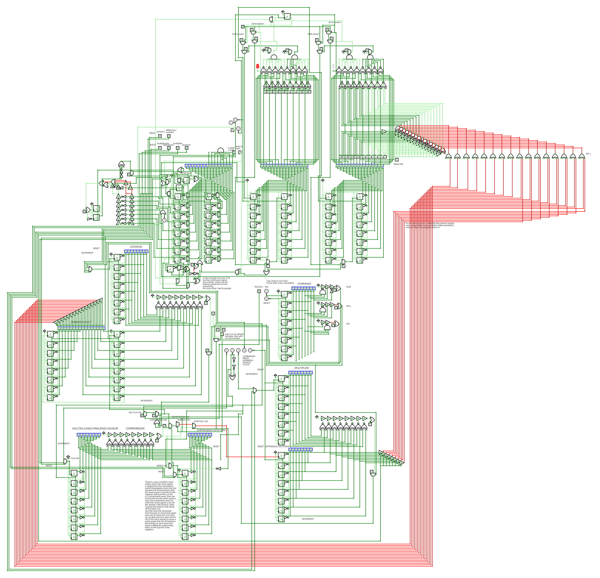

# microcontroller

## Overview
Gate-level (almost) 16-bit microcontroller. Uses gates, flip-flops, and multiplexers.
It features 4 opcodes and it's able to do 8-bit addition, subtraction, multiplication, and division via four general purpose registers.
Also has dual 16-bit busses, a 16-bit sum/product output register, and a central accumulator.

This was originally mocked up in my Gr12 Advanced Functions class. I had virtually no knowledge on how ALUs or any other component in a CPU worked, but this was my attempt at building one from a blank state of mind. Since it uses the clock to count up to add instead of doing logical operations for addition, (I didn't know that that was a thing at that point) I was able to do an optimization where if both of the numbers that were to be added were larger than 255, it would start counting up from the 9th bit along with the 1st bit so all addition operations would take no longer than 255 clock cycles even if the sum was larger than 255.

I used [CircuitVerse](https://circuitverse.org/simulator) to make this.
